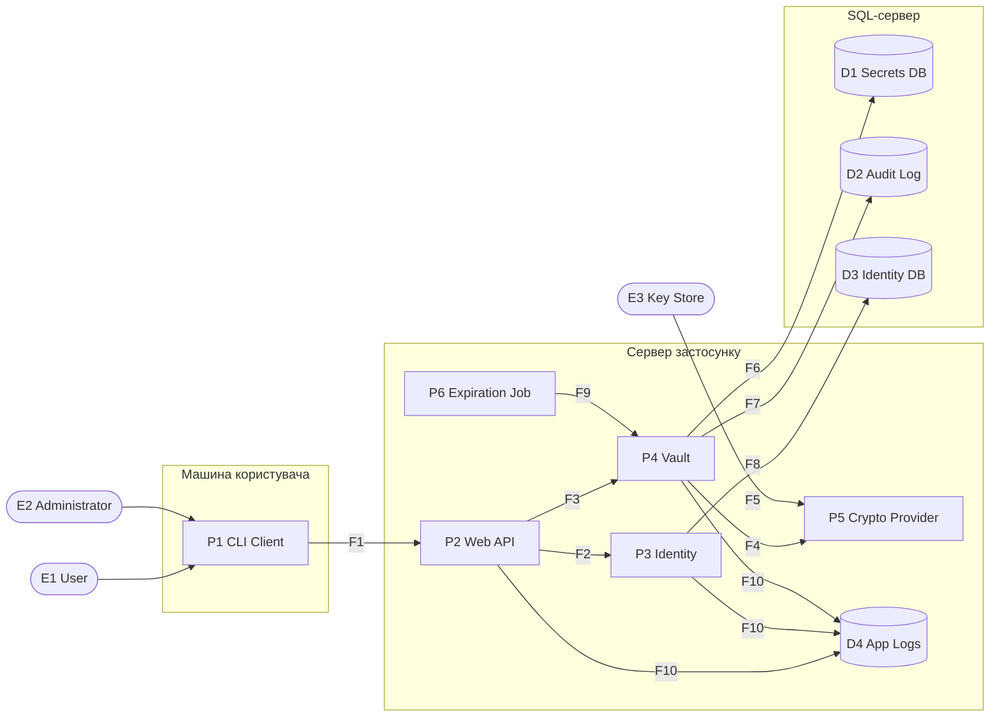

# Threat Model — Secure Vault Service

| | |
| --- | --- |
| Назва | Модель загроз — `Secure Vault Service` |
| Версія | 0.1.0 |
| Статус | Draft |
| Останнє оновлення | 2026-11-04 |
| Власник | Kostia (Developer / Project Owner) |
| Пов'язані документи | `docs/policy/project_policy.md`, `docs/policy/security_policy.md`, `docs/policy/privacy_policy.md`, `docs/internal_spec/Vault/business_logic.md` |

## Scope

Модель охоплює весь проєкт Secure Vault Service у цільовій архітектурі модульного моноліту:

- CLI-клієнт, через який користувач та адміністратор працюють із системою;
- серверний Web API (шар `Presentation`);
- модуль `Identity` (автентифікація, керування обліковими записами, ролі), що працює в тому самому процесі застосунку;
- модуль `Vault` (шари `Application` і `Domain`), у тому числі фонову задачу позначення прострочених секретів;
- криптопровайдер (`Infrastructure/Cryptography`) та зовнішнє сховище майстер-ключа;
- SQL-базу даних (секрети, журнал аудиту, облікові записи) та журнали застосунку;
- потоки даних між цими елементами.

Модель описує систему на етапі проєктування: код ще не реалізовано, тому загрози формулюються щодо архітектури та специфікації (`business_logic.md`), а не щодо конкретної реалізації.

Поза межами моделі:

- середовище розгортання та хостингу (ОС серверів, контейнеризація, хмарна інфраструктура, мережеве обладнання);
- фізичний доступ до обладнання;
- захищеність робочої станції користувача, на якій запущено CLI (шкідливе ПЗ, компрометація ОС);
- внутрішня реалізація зовнішнього сховища ключів (Key Vault) та СКБД;
- конкретний вибір СКБД (на момент створення документа не визначено; припускається SQL-сервер).

## System Overview

Secure Vault Service — багатокористувацький сервіс централізованого зберігання секретів. Користувач через CLI передає секрет на сервер, де той шифрується за AES-256-GCM і зберігається в БД. Кожен користувач має доступ виключно до власних секретів. Адміністратор керує обліковими записами, але не має права читати чужі секрети. Майстер-ключ шифрування зберігається поза застосунком і БД: у змінних середовища (розробка) або в Key Vault (продакшн).

Типи елементів DFD: **External Interactor** — зовнішній користувач або система; **Process** — компонент, що виконує обробку; **Data Store** — сховище даних; **Data Flow** — передавання даних між елементами; **Trust Boundary** — межа між областями з різним рівнем довіри.

**Елементи системи:**

| ID | DFD Type | Name | Опис |
| --- | --- | --- | --- |
| E1 | External Interactor | User | Власник секретів; працює лише з власними записами. |
| E2 | External Interactor | Administrator | Керує обліковими записами та ролями; доступу до вмісту чужих секретів не має. |
| E3 | External Interactor | Key Store | Змінні середовища / Key Vault, що зберігають майстер-ключ. |
| P1 | Process | CLI Client | Консольний клієнт на машині користувача; надсилає запити до API. |
| P2 | Process | Web API | Шар `Presentation`: ендпоінти, middleware, перевірка токенів. |
| P3 | Process | Identity | Автентифікація, видача токенів доступу, керування обліковими записами та ролями. |
| P4 | Process | Vault | Шари `Application` + `Domain`: CQRS-команди/запити, доменні політики, аудит. |
| P5 | Process | Crypto Provider | Реалізація `ICryptoProvider` (AES-256-GCM). |
| P6 | Process | Expiration Job | Фонова задача `MarkSecretsAsExpiredAC`. |
| D1 | Data Store | Secrets DB | Таблиця `SecretItem` (шифротекст, IV, статус, метадані). |
| D2 | Data Store | Audit Log | Таблиця `AuditLog` (append-only). |
| D3 | Data Store | Identity DB | Облікові записи, хеші паролів, ролі. |
| D4 | Data Store | Application Logs | Технічні журнали застосунку. |
| F1 | Data Flow | CLI Client -> Web API | Запити користувача/адміністратора та відповіді (у т.ч. відкриті значення секретів). |
| F2 | Data Flow | Web API -> Identity | Облікові дані при вході; токени на перевірку. |
| F3 | Data Flow | Web API -> Vault | Команди та запити з контекстом автентифікованого користувача. |
| F4 | Data Flow | Vault -> Crypto Provider | Відкриті дані на шифрування / шифротекст на розшифрування. |
| F5 | Data Flow | Key Store -> Crypto Provider | Завантаження майстер-ключа. |
| F6 | Data Flow | Vault -> Secrets DB | Збереження та читання `SecretItem`. |
| F7 | Data Flow | Vault -> Audit Log | Запис подій аудиту. |
| F8 | Data Flow | Identity -> Identity DB | Читання/запис облікових записів. |
| F9 | Data Flow | Expiration Job -> Vault | Системна команда позначення прострочених секретів. |
| F10 | Data Flow | Web API / Identity / Vault -> Application Logs | Технічні повідомлення та помилки. |
| TB1 | Trust Boundary | Machine of User / Server | Між CLI на машині користувача та сервером (мережа). |
| TB2 | Trust Boundary | Application / Database Server | Між процесом застосунку та SQL-сервером. |
| TB3 | Trust Boundary | Application / Key Store | Між застосунком і зовнішнім сховищем ключа. |
| TB4 | Trust Boundary | Operator / Runtime Environment | Між адміністратором середовища та запущеним застосунком і його конфігурацією. |

**Зв'язки:**

- `E1 User` та `E2 Administrator` взаємодіють із `P1 CLI Client`.
- `P1 CLI Client` передає запити до `P2 Web API` через `F1`; `F1` перетинає `TB1`.
- `P2 Web API` передає облікові дані та токени до `P3 Identity` через `F2`; `P3 Identity` читає та змінює `D3 Identity DB` через `F8`, що перетинає `TB2`.
- `P2 Web API` передає команди й запити з ідентифікатором користувача до `P4 Vault` через `F3`.
- `P4 Vault` передає дані на шифрування/розшифрування до `P5 Crypto Provider` через `F4`; `P5` отримує майстер-ключ від `E3 Key Store` через `F5`, що перетинає `TB3`.
- `P4 Vault` зберігає секрети в `D1 Secrets DB` (`F6`) та події аудиту в `D2 Audit Log` (`F7`); обидва потоки перетинають `TB2`.
- `P6 Expiration Job` ініціює системну зміну статусу через `P4 Vault` (`F9`).
- `P2`, `P3`, `P4` записують технічні повідомлення до `D4 Application Logs` (`F10`).
- `E2 Administrator` у ролі оператора має доступ до конфігурації середовища через `TB4`.

## Threat Actors

Модель порушника визначає суб'єктів, здатних реалізувати загрози з розділу STRIDE Analysis. Для кожного порушника зазначено, до яких інтерфейсів та елементів DFD він має доступ і які привілеї має на старті.

Ролі в системі: **User** — працює лише з власними секретами; **Administrator** — бачить метадані секретів (ID, назва, статус, дати) усіх користувачів і може блокувати облікові записи, але не має доступу до вмісту чужих секретів і не може скидати паролі. Реєстрація облікових записів відкрита.

| ID | Порушник | Доступні інтерфейси / елементи | Початкові привілеї | Можливості та цілі | Обмеження |
| --- | --- | --- | --- | --- | --- |
| A1 | Зовнішній неавтентифікований порушник | `F1` (публічні ендпоінти `P2 Web API`), реєстрація та вхід у `P3 Identity` | Відсутні; може самостійно зареєструвати обліковий запис і стати A2 | Підбір паролів, масова реєстрація, перевантаження API, сканування ендпоінтів, пошук помилок, що розкривають внутрішню інформацію | Не має валідного токена чужого користувача; не має доступу до мережі сервера, БД і Key Store |
| A2 | Легітимний користувач | `P1 CLI Client`, `F1`, усі ендпоінти, доступні ролі User | Валідний обліковий запис і токен ролі User | Спроби прочитати, відкликати чи змінити чужі секрети підстановкою ID (IDOR), читання відкликаних/прострочених секретів, отримання ролі Administrator, заперечення власних дій | Знає лише власні облікові дані; не має доступу до серверної інфраструктури |
| A3 | Порушник зі скомпрометованим обліковим записом | Ті самі, що в жертви (A2 або Administrator) | Викрадений пароль або токен доступу (фішинг, витік, кеш токена в CLI на машині жертви) | Читання та відкликання секретів жертви від її імені; для викраденого адмін-акаунта — блокування користувачів і перегляд метаданих | Обмежений привілеями жертви; дії фіксуються в аудиті під її ідентичністю |
| A4 | Зловмисний адміністратор | `P1 CLI Client`, адміністративні ендпоінти `P2`/`P3` | Роль Administrator у застосунку | Спроба прочитати вміст чужих секретів, отримати права власника, необґрунтовано блокувати користувачів, аналізувати метадані (назви секретів) для збору інформації, приховати свої дії | Не має доступу до майстер-ключа, БД і середовища розгортання (інакше це A7); не може скидати паролі |
| A5 | Порушник із доступом до БД | `D1`, `D2`, `D3` напряму (витік бекапу, SQL-ін'єкція, скомпрометовані облікові дані СКБД) | Читання та/або запис у таблиці БД | Аналіз шифротекстів і метаданих, підміна шифротексту/IV, зміна статусу (`REVOKED` → `ACTIVE`), зміна власника запису, видалення чи редагування `AuditLog`, офлайн-підбір хешів паролів | Не має майстер-ключа: без `E3 Key Store` не може розшифрувати секрети |
| A6 | Мережевий порушник (MITM) | `F1` між машиною користувача та сервером (`TB1`); потоки `F5`–`F8` за наявності доступу до внутрішньої мережі | Можливість перехоплювати або змінювати мережевий трафік | Перехоплення облікових даних, токенів і відкритих значень секретів у відповідях, повторне відтворення запитів (replay), підміна відповідей | Не може розшифрувати коректно налаштований TLS |
| A7 | Оператор середовища виконання | `TB4`: конфігурація, змінні середовища, `D4 Application Logs`, процес застосунку | Адміністративний доступ до сервера / середовища розгортання | Отримання майстер-ключа зі змінних середовища, читання журналів (пошук секретів і токенів у логах), заміна конфігурації або збірки | Захист самого середовища поза скоупом; модель розглядає лише те, що застосунок розкриває оператору |
| A8 | Скомпрометована залежність | Процес застосунку (`P2`–`P6`) | Виконання коду з правами застосунку | Перехоплення відкритих даних і майстер-ключа в пам'яті, ексфільтрація даних, обхід перевірок | Обмежена правами процесу; вводиться лише через ланцюг постачання (NuGet) |
| A9 | Зловмисний розробник або ШІ-агент | Репозиторій, CI/CD, вихідний код | Право робити коміти та відкривати pull request | Внесення бекдору, послаблення авторизації чи криптографії, додавання секретів у код, вимкнення тестів або архітектурних перевірок | Зміни проходять рев'ю та автоматизовані перевірки, визначені політикою безпеки |

## STRIDE Analysis

Аналіз виконано за спрощеною методологією STRIDE для елементів DFD із розділу System Overview. Канонічна відповідність категорій STRIDE типам елементів:

| DFD Element | S | T | R | I | D | E |
| --- | :---: | :---: | :---: | :---: | :---: | :---: |
| External Interactor | ✓ |  | ✓ |  |  |  |
| Data Flow |  | ✓ |  | ✓ | ✓ |  |
| Data Store |  | ✓ |  | ✓ | ✓ |  |
| Process | ✓ | ✓ | ✓ | ✓ | ✓ | ✓ |

Позначення: **S** — Spoofing; **T** — Tampering; **R** — Repudiation; **I** — Information Disclosure; **D** — Denial of Service; **E** — Elevation of Privilege.

Заповнено лише релевантні категорії. Кожна загроза має ідентифікатор `T-XX` і посилання на порушників із розділу Threat Actors. Одна слабкість може породжувати кілька загроз різних категорій. Потоки з однаковим профілем загроз згруповано. Контрзаходи в цьому документі не наводяться: вони визначаються в `security_policy.md` з посиланням на ідентифікатори загроз.

| Element | S | T | R | I | D | E |
| --- | --- | --- | --- | --- | --- | --- |
| **E1 User** *(External Interactor)* | **T-01** Порушник автентифікується від імені користувача, використавши викрадений пароль або токен доступу. *(A3)* | - | **T-02** Користувач заперечує читання або відкликання секрету: специфікація `AuditLog` не містить ідентифікатора суб'єкта, що виконав дію. *(A2)* | - | - | - |
| **E2 Administrator** *(External Interactor)* | **T-03** Захоплення облікового запису адміністратора дає змогу блокувати будь-яких користувачів і переглядати метадані всіх секретів. *(A1, A3)* | - | **T-04** Адміністратор заперечує блокування користувача: адміністративні дії не входять до переліку подій аудиту. *(A4)* | - | - | - |
| **E3 Key Store** *(External Interactor)* | **T-05** Змінена конфігурація спрямовує застосунок до підробленого сховища ключів; нові секрети шифруються ключем, відомим порушнику. *(A7)* | - | - | - | - | - |
| **P1 CLI Client** *(Process)* | **T-06** Користувача спрямовують на підроблений сервер (змінена адреса API), і CLI надсилає йому облікові дані. *(A6)* | **T-07** Користувач встановлює модифіковану збірку CLI з неофіційного джерела, яка пересилає секрети порушнику. *(A8, A9)* | - | **T-08** Відкрите значення секрету, передане аргументом командного рядка або виведене в консоль, залишається в історії оболонки, списку процесів чи логах терміналу; токен зберігається у відкритому файлі на диску. *(A3)* | - | - |
| **P2 Web API** *(Process)* | **T-09** API приймає токен із недійсним підписом, простроченим строком дії, чужою аудиторією або алгоритмом `none`. *(A1, A6)* | **T-10** Клієнт передає в тілі запиту службові поля (`ownerId`, `status`, `createdAtUtc`), які API без фільтрації зв'язує з командою (mass assignment). *(A2)* | **T-11** Запит не має кореляційного ідентифікатора, тому технічний журнал неможливо зіставити із записом аудиту під час розслідування. *(A2, A4)* | **T-12** Відповіді з трасуванням стеку або текстом внутрішніх винятків розкривають структуру системи; різні відповіді «не існує» та «немає доступу» дозволяють перебирати ID чужих секретів. *(A1, A2)* | **T-13** Масові запити, надвеликі тіла запитів або значення секретів вичерпують ресурси API. *(A1)* | **T-14** Відсутня перевірка ролі на адміністративному ендпоінті дозволяє користувачу з роллю User блокувати інших користувачів або переглядати чужі метадані. *(A2)* |
| **P3 Identity** *(Process)* | **T-15** Підбір паролів і credential stuffing через ендпоінт входу. *(A1)* | **T-16** Зміна пароля або профілю без підтвердження поточного пароля дозволяє закріпитися у викраденому обліковому записі. *(A3)* | **T-17** Входи, невдалі спроби входу та блокування облікових записів не фіксуються, тому атаку на обліковий запис неможливо відстежити. *(A1, A4)* | **T-18** Різні повідомлення під час входу та відкритої реєстрації («користувача не існує», «email зайнятий») розкривають існування облікових записів. *(A1)* | **T-19** Автоматичне блокування після N невдалих спроб використовується для блокування легітимних користувачів; масові запити до ресурсомісткого хешування паролів перевантажують сервер. *(A1)* | **T-20** Під час відкритої реєстрації клієнт передає параметр ролі й отримує роль Administrator. *(A1)*  **T-21** Заблокований користувач продовжує працювати з виданим раніше токеном до закінчення його строку дії. *(A2)* |
| **P4 Vault** *(Process)* | **T-22** Vault бере ідентифікатор користувача з параметрів запиту, а не з перевіреного контексту автентифікації, тож користувач діє від імені іншого. *(A2)* | **T-23** Зміна чужого секрету через `UpdateSecretPayloadAC` або обхід матриці переходів (повернення `REVOKED` → `ACTIVE`). *(A2)*  **T-24** SQL-ін'єкція через динамічно сформовані запити до БД. *(A1, A2)* | **T-25** Відмовлені спроби доступу (до чужого, відкликаного чи простроченого секрету) не фіксуються: `AuditActionVO` містить лише успішні дії. *(A2)* | **T-26** IDOR: користувач читає чужий секрет через `GetSecretAQ`, підставивши його ID, бо `SecretItem` не містить власника. *(A2)*  **T-27** Назви секретів, видимі адміністратору через `ListSecretsMetadataAQ`, самі розкривають чутливу інформацію (наприклад, `bank-prod-db-password`). *(A4)* | **T-28** Користувач створює необмежену кількість секретів, вичерпуючи сховище. *(A2)* | **T-29** Адміністратор отримує вміст чужого секрету через спільний з користувачами запит `GetSecretAQ`. *(A4)* |
| **P5 Crypto Provider** *(Process)* | - | **T-30** Повторне використання nonce в AES-GCM (некоректна генерація IV або розбіжність 12 / 16 байт між документами) дозволяє підробити шифротекст і розкрити відкриті дані. *(A5)* | - | **T-31** Відкриті дані й майстер-ключ залишаються в пам'яті процесу та потрапляють у дампи пам'яті або повідомлення винятків. *(A7, A8)* | **T-32** Недоступність Key Store під час старту чи роботи унеможливлює шифрування та розшифрування, і сервіс стає повністю недоступним. *(A7)* | - |
| **P6 Expiration Job** *(Process)* | - | **T-33** Зміщення системного часу або помилка з часовими зонами спричиняє передчасне чи відсутнє прострочення секретів. *(A7)* | **T-34** Системні зміни статусу (`ACTIVE` → `EXPIRED`) не потрапляють до аудиту: у `AuditActionVO` немає відповідної дії. *(—)* | - | - | **T-35** Поки задача не виконалась або вона збоїть, прострочений секрет лишається `ACTIVE` і читається: `AccessSecretDPolicy` перевіряє статус, а не `expiresAtUtc`. *(A2, A3)* |
| **D1 Secrets DB** *(Data Store)* | - | **T-36** Пряма зміна статусу (`REVOKED` → `ACTIVE`) або власника запису в БД. *(A5)*  **T-37** Перестановка шифротексту між записами (splicing): шифротекст не прив'язаний до ID запису через AAD, тож чужий секрет видається під іншим ID. *(A5)* | - | **T-38** Витік БД або бекапу розкриває метадані (назви, власників, дати) у відкритому вигляді та шифротексти для офлайн-аналізу. *(A5)* | **T-39** Видалення чи пошкодження записів або таблиці призводить до незворотної втрати секретів за відсутності резервних копій. *(A5)* | - |
| **D2 Audit Log** *(Data Store)* | - | **T-40** Видалення або редагування записів аудиту безпосередньо в БД: append-only гарантується лише кодом застосунку. *(A5, A7)* | - | **T-41** Журнал аудиту розкриває, хто, коли й до яких секретів звертався. *(A5)* | **T-42** Масові операції спричиняють необмежене зростання таблиці аудиту. *(A1, A2)* | - |
| **D3 Identity DB** *(Data Store)* | - | **T-43** Пряма зміна ролі на Administrator, хешу пароля або статусу блокування в БД. *(A5)* | - | **T-44** Витік хешів паролів уможливлює їх офлайн-підбір. *(A5)* | Спільний SQL-сервер: див. загрозу видалення чи пошкодження даних у `D1`. | - |
| **D4 Application Logs** *(Data Store)* | - | **T-45** Ін'єкція символів нового рядка у вхідні дані (log injection) підробляє записи журналу. *(A2)* | - | **T-46** Відкриті значення секретів, паролі, токени, рядок підключення до БД або майстер-ключ потрапляють у журнали. *(A7)* | **T-47** Масові помилкові запити переповнюють диск журналами. *(A1)* | - |
| **F1 CLI Client -> Web API** *(Data Flow)* | - | **T-48** Без TLS або з вимкненою перевіркою сертифіката в CLI запити й відповіді змінюються в дорозі чи відтворюються повторно (replay). *(A6)* | - | **T-49** Перехоплення облікових даних, токенів і відкритих значень секретів у відповідях. *(A6)* | **T-50** Блокування або перевантаження каналу між клієнтом і сервером. *(A1, A6)* | - |
| **F2–F4, F9 (внутрішні виклики в процесі)** *(Data Flow)* | - | - | - | **T-51** Відкриті дані передаються між модулями в пам'яті одного процесу; перехопити їх може лише код, виконаний у процесі застосунку. Потоки не перетинають меж довіри, тому окремих загроз T та D не мають. *(A8)* | - | - |
| **F5 Key Store -> Crypto Provider** *(Data Flow)* | - | Див. загрозу підміни джерела ключа для `E3`. | - | **T-52** Майстер-ключ передається незахищеним каналом або дублюється в конфігураційних файлах і журналах запуску. *(A6, A7)* | Див. загрозу недоступності Key Store для `P5`. | - |
| **F6–F8 Application -> Database** *(Data Flow)* | - | **T-53** Без шифрування з'єднання з SQL-сервером запити й результати змінюються в дорозі. *(A6)* | - | **T-54** Перехоплення облікових даних СКБД, хешів паролів, метаданих і шифротекстів. *(A6)* | **T-55** Вичерпання пулу з'єднань з БД масовими запитами. *(A1)* | - |
| **F10 Application -> Logs** *(Data Flow)* | - | Див. log injection для `D4`. | - | Див. потрапляння чутливих даних у журнали для `D4`. | Див. переповнення журналів для `D4`. | - |

### Threat Register

Пріоритет визначено експертно з урахуванням наслідків для конфіденційності секретів і ймовірності реалізації: **High** — пряма компрометація секретів, облікових записів або ключа; **Medium** — часткове розкриття, обхід окремих обмежень або порушення доступності; **Low** — обмежені наслідки.

| ID | Element | Category | Threat Actors | Priority | Загроза |
| --- | --- | --- | --- | --- | --- |
| T-01 | E1 | Spoofing | A3 | High | Порушник автентифікується від імені користувача, використавши викрадений пароль або токен доступу. |
| T-02 | E1 | Repudiation | A2 | Medium | Користувач заперечує читання або відкликання секрету: специфікація `AuditLog` не містить ідентифікатора суб'єкта, що виконав дію. |
| T-03 | E2 | Spoofing | A1, A3 | High | Захоплення облікового запису адміністратора дає змогу блокувати будь-яких користувачів і переглядати метадані всіх секретів. |
| T-04 | E2 | Repudiation | A4 | Medium | Адміністратор заперечує блокування користувача: адміністративні дії не входять до переліку подій аудиту. |
| T-05 | E3 | Spoofing | A7 | Medium | Змінена конфігурація спрямовує застосунок до підробленого сховища ключів; нові секрети шифруються ключем, відомим порушнику. |
| T-06 | P1 | Spoofing | A6 | Medium | Користувача спрямовують на підроблений сервер (змінена адреса API), і CLI надсилає йому облікові дані. |
| T-07 | P1 | Tampering | A8, A9 | Medium | Користувач встановлює модифіковану збірку CLI з неофіційного джерела, яка пересилає секрети порушнику. |
| T-08 | P1 | Information Disclosure | A3 | High | Відкрите значення секрету, передане аргументом командного рядка або виведене в консоль, залишається в історії оболонки, списку процесів чи логах терміналу; токен зберігається у відкритому файлі на диску. |
| T-09 | P2 | Spoofing | A1, A6 | High | API приймає токен із недійсним підписом, простроченим строком дії, чужою аудиторією або алгоритмом `none`. |
| T-10 | P2 | Tampering | A2 | Medium | Клієнт передає в тілі запиту службові поля (`ownerId`, `status`, `createdAtUtc`), які API без фільтрації зв'язує з командою (mass assignment). |
| T-11 | P2 | Repudiation | A2, A4 | Low | Запит не має кореляційного ідентифікатора, тому технічний журнал неможливо зіставити із записом аудиту під час розслідування. |
| T-12 | P2 | Information Disclosure | A1, A2 | Medium | Відповіді з трасуванням стеку або текстом внутрішніх винятків розкривають структуру системи; різні відповіді «не існує» та «немає доступу» дозволяють перебирати ID чужих секретів. |
| T-13 | P2 | Denial of Service | A1 | Medium | Масові запити, надвеликі тіла запитів або значення секретів вичерпують ресурси API. |
| T-14 | P2 | Elevation of Privilege | A2 | High | Відсутня перевірка ролі на адміністративному ендпоінті дозволяє користувачу з роллю User блокувати інших користувачів або переглядати чужі метадані. |
| T-15 | P3 | Spoofing | A1 | High | Підбір паролів і credential stuffing через ендпоінт входу. |
| T-16 | P3 | Tampering | A3 | Medium | Зміна пароля або профілю без підтвердження поточного пароля дозволяє закріпитися у викраденому обліковому записі. |
| T-17 | P3 | Repudiation | A1, A4 | Medium | Входи, невдалі спроби входу та блокування облікових записів не фіксуються, тому атаку на обліковий запис неможливо відстежити. |
| T-18 | P3 | Information Disclosure | A1 | Low | Різні повідомлення під час входу та відкритої реєстрації («користувача не існує», «email зайнятий») розкривають існування облікових записів. |
| T-19 | P3 | Denial of Service | A1 | Medium | Автоматичне блокування після N невдалих спроб використовується для блокування легітимних користувачів; масові запити до ресурсомісткого хешування паролів перевантажують сервер. |
| T-20 | P3 | Elevation of Privilege | A1 | High | Під час відкритої реєстрації клієнт передає параметр ролі й отримує роль Administrator. |
| T-21 | P3 | Elevation of Privilege | A2 | Medium | Заблокований користувач продовжує працювати з виданим раніше токеном до закінчення його строку дії. |
| T-22 | P4 | Spoofing | A2 | High | Vault бере ідентифікатор користувача з параметрів запиту, а не з перевіреного контексту автентифікації, тож користувач діє від імені іншого. |
| T-23 | P4 | Tampering | A2 | High | Зміна чужого секрету через `UpdateSecretPayloadAC` або обхід матриці переходів (повернення `REVOKED` → `ACTIVE`). |
| T-24 | P4 | Tampering | A1, A2 | High | SQL-ін'єкція через динамічно сформовані запити до БД. |
| T-25 | P4 | Repudiation | A2 | Medium | Відмовлені спроби доступу (до чужого, відкликаного чи простроченого секрету) не фіксуються: `AuditActionVO` містить лише успішні дії. |
| T-26 | P4 | Information Disclosure | A2 | High | IDOR: користувач читає чужий секрет через `GetSecretAQ`, підставивши його ID, бо `SecretItem` не містить власника. |
| T-27 | P4 | Information Disclosure | A4 | Medium | Назви секретів, видимі адміністратору через `ListSecretsMetadataAQ`, самі розкривають чутливу інформацію (наприклад, `bank-prod-db-password`). |
| T-28 | P4 | Denial of Service | A2 | Low | Користувач створює необмежену кількість секретів, вичерпуючи сховище. |
| T-29 | P4 | Elevation of Privilege | A4 | High | Адміністратор отримує вміст чужого секрету через спільний з користувачами запит `GetSecretAQ`. |
| T-30 | P5 | Tampering | A5 | High | Повторне використання nonce в AES-GCM (некоректна генерація IV або розбіжність 12 / 16 байт між документами) дозволяє підробити шифротекст і розкрити відкриті дані. |
| T-31 | P5 | Information Disclosure | A7, A8 | Medium | Відкриті дані й майстер-ключ залишаються в пам'яті процесу та потрапляють у дампи пам'яті або повідомлення винятків. |
| T-32 | P5 | Denial of Service | A7 | Medium | Недоступність Key Store під час старту чи роботи унеможливлює шифрування та розшифрування, і сервіс стає повністю недоступним. |
| T-33 | P6 | Tampering | A7 | Low | Зміщення системного часу або помилка з часовими зонами спричиняє передчасне чи відсутнє прострочення секретів. |
| T-34 | P6 | Repudiation | — | Low | Системні зміни статусу (`ACTIVE` → `EXPIRED`) не потрапляють до аудиту: у `AuditActionVO` немає відповідної дії. |
| T-35 | P6 | Elevation of Privilege | A2, A3 | Medium | Поки задача не виконалась або вона збоїть, прострочений секрет лишається `ACTIVE` і читається: `AccessSecretDPolicy` перевіряє статус, а не `expiresAtUtc`. |
| T-36 | D1 | Tampering | A5 | High | Пряма зміна статусу (`REVOKED` → `ACTIVE`) або власника запису в БД. |
| T-37 | D1 | Tampering | A5 | Medium | Перестановка шифротексту між записами (splicing): шифротекст не прив'язаний до ID запису через AAD, тож чужий секрет видається під іншим ID. |
| T-38 | D1 | Information Disclosure | A5 | Medium | Витік БД або бекапу розкриває метадані (назви, власників, дати) у відкритому вигляді та шифротексти для офлайн-аналізу. |
| T-39 | D1 | Denial of Service | A5 | Medium | Видалення чи пошкодження записів або таблиці призводить до незворотної втрати секретів за відсутності резервних копій. |
| T-40 | D2 | Tampering | A5, A7 | High | Видалення або редагування записів аудиту безпосередньо в БД: append-only гарантується лише кодом застосунку. |
| T-41 | D2 | Information Disclosure | A5 | Low | Журнал аудиту розкриває, хто, коли й до яких секретів звертався. |
| T-42 | D2 | Denial of Service | A1, A2 | Low | Масові операції спричиняють необмежене зростання таблиці аудиту. |
| T-43 | D3 | Tampering | A5 | High | Пряма зміна ролі на Administrator, хешу пароля або статусу блокування в БД. |
| T-44 | D3 | Information Disclosure | A5 | Medium | Витік хешів паролів уможливлює їх офлайн-підбір. |
| T-45 | D4 | Tampering | A2 | Low | Ін'єкція символів нового рядка у вхідні дані (log injection) підробляє записи журналу. |
| T-46 | D4 | Information Disclosure | A7 | High | Відкриті значення секретів, паролі, токени, рядок підключення до БД або майстер-ключ потрапляють у журнали. |
| T-47 | D4 | Denial of Service | A1 | Low | Масові помилкові запити переповнюють диск журналами. |
| T-48 | F1 | Tampering | A6 | High | Без TLS або з вимкненою перевіркою сертифіката в CLI запити й відповіді змінюються в дорозі чи відтворюються повторно (replay). |
| T-49 | F1 | Information Disclosure | A6 | High | Перехоплення облікових даних, токенів і відкритих значень секретів у відповідях. |
| T-50 | F1 | Denial of Service | A1, A6 | Low | Блокування або перевантаження каналу між клієнтом і сервером. |
| T-51 | F2–F4, | Information Disclosure | A8 | Medium | Відкриті дані передаються між модулями в пам'яті одного процесу; перехопити їх може лише код, виконаний у процесі застосунку. Потоки не перетинають меж довіри, тому окремих загроз T та D не мають. |
| T-52 | F5 | Information Disclosure | A6, A7 | High | Майстер-ключ передається незахищеним каналом або дублюється в конфігураційних файлах і журналах запуску. |
| T-53 | F6–F8 | Tampering | A6 | Medium | Без шифрування з'єднання з SQL-сервером запити й результати змінюються в дорозі. |
| T-54 | F6–F8 | Information Disclosure | A6 | Medium | Перехоплення облікових даних СКБД, хешів паролів, метаданих і шифротекстів. |
| T-55 | F6–F8 | Denial of Service | A1 | Low | Вичерпання пулу з'єднань з БД масовими запитами. |

## Open Issues

[Буде написано: прогалини специфікації, виявлені під час аналізу]
